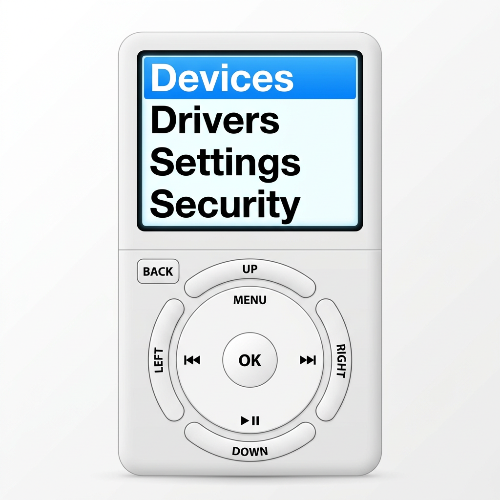

# Loca Nova

Our mission is to help elderly people by making modern technology accessible and easy to use.  
Modern smart homes are too complex for them, so with **Loca Nova**, we turn a smartphone into a simple remote with large buttons and a familiar retro design that works **100% without the internet**.

---

## Documentation & Architecture

* **Full Specifications:** Read [PROJECT_BRIEF.md](docs/PROJECT_BRIEF.md) for complete details regarding the universal device-control architecture, security framework, and accessibility goals.
* **Target Platform (V1):** Native Android application (`.apk`) with an embedded, protocol-agnostic local Core.
* **Reference Prototype:** The root `main.py` file serves solely as an initial local JSON-validation reference prototype and does not restrict the final Android architecture.

## Repository Structure

To maintain strict module isolation and future-proof expansion, the project is organized into five core directories corresponding to our V1 development roadmap:

* **`core/`** — Protocol-agnostic Core engine, JSON schema validator, Communication Router, and Device Registry *(Issue #2)*.
* **`drivers/`** — Isolated local device drivers (Wi-Fi / Bluetooth) and declarative JSON device profiles *(Issue #3)*.
* **`ui/`** — Classic MP3-player split-screen layout, 10-button wheel navigation, and color-coded accessibility controls *(Issue #1)*.
* **`security/`** — Zero-trust Security Portal, Level 1 & Level 2 authentication, and hardware-backed PIN/password storage *(Issue #4)*.
* **`app/`** — Main Android application entry point integrating all modules into the final Version 1 MVP *(Issue #5)*.

## Get Involved & Contact

We welcome feedback, ideas, and contributions to our open device drivers and core architecture:

* **Discussions:** Join the conversation or ask questions in [GitHub Discussions](https://github.com).
* **Issues:** Check our open [V1 Roadmap Issues](https://github.com) to see current tasks.

---

## License & Future Versions

Version 1 (MVP) of **Loca Nova** is licensed under the **Apache License 2.0** — see the [LICENSE](LICENSE) file for details.

* **Trademark Protection:** In accordance with Section 6 of the Apache License 2.0, this license does **not** grant permission to use the trade names, trademarks, service marks, or product names of **Loca Nova** or **jordan-nova** to distribute derivative or competing products without explicit written authorization.
* **Future Releases & Modular Evolution:** As the sole copyright holder (`© 2026 jordan-nova`), the author reserves the right to change licensing terms, introduce proprietary UI components, and release specialized modules under commercial or private licenses in future versions (V2+).

